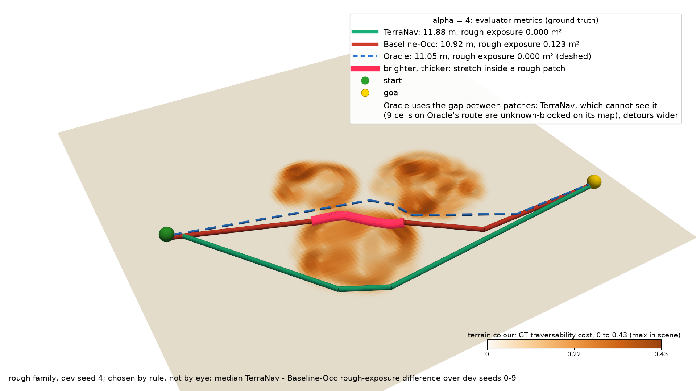
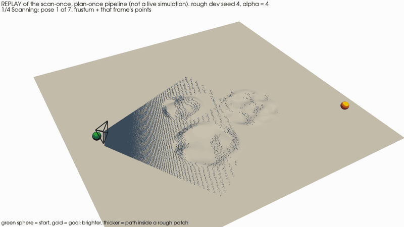
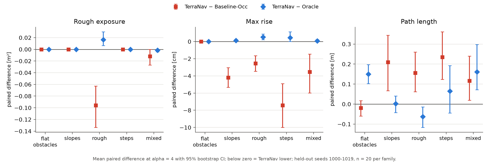
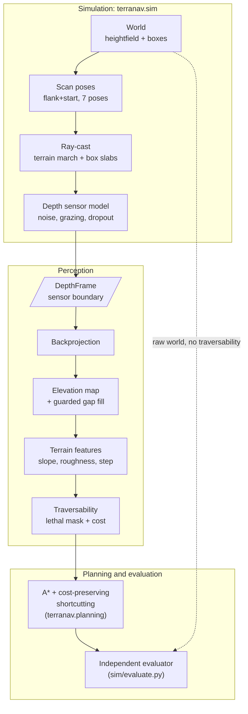
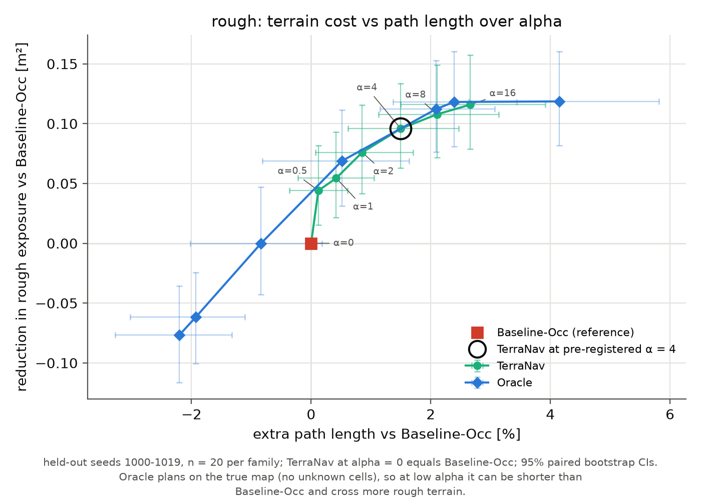

# TerraNav

A robot looks at rough ground with a depth camera, maps it, and picks a route that avoids the
worst terrain for a slightly longer drive.

Simulated depth camera → 2.5D elevation map → slope / roughness / step traversability →
cost-weighted A*, scored by an evaluator that sees only the raw world. Python, NumPy, SciPy;
no ROS, no GPU, no learned components.

Over **100 held-out scenarios** (5 terrain families × 20, protocol fixed before the run):

- **81 % less rough-ground exposure** in the rough family, and an **80–96 % lower largest
  climb** in the four terrain families.
- **1–2 % longer paths** (1.0–2.1 % by family) and **zero violations** for every planner.
- **≈ 45 ms per scenario** for perception, traversability and planning (42–47 ms by family,
  simulation excluded).

*Largest climb* = the evaluator's max rise: the largest height change between two points on
the path at most 0.2 m apart, measured on the true surface.





*Replay of the scan-once / plan-once pipeline on rough dev seed 4, picked by a fixed rule (the
median dev-seed rough-exposure difference), not by eye. Here TerraNav avoids the rough ground
for +0.95 m (+8.7 %) over Baseline-Occ, a longer detour than the rough family's held-out mean
of +1.4 %.*

| family | metric | Baseline-Occ → TerraNav | 95 % CI of the difference | extra length |
|---|---|---|---|---|
| rough | rough exposure | 0.1186 → 0.0228 m² (−81 %) | [−0.1335, −0.0629] m² | +1.4 % |
| rough | largest climb | 3.19 → 0.65 cm (−80 %) | [−3.47, −1.66] cm | +1.4 % |
| slopes | largest climb | 4.45 → 0.26 cm (−94 %) | [−5.31, −3.03] cm | +1.9 % |
| steps | largest climb | 7.88 → 0.45 cm (−94 %) | [−9.99, −4.91] cm | +2.1 % |
| mixed | largest climb | 3.68 → 0.15 cm (−96 %) | [−5.98, −1.47] cm | +1.0 % |

Means over 20 held-out scenarios per family at α = 4; CI = paired percentile bootstrap of
TerraNav − Baseline-Occ. Sources and arithmetic in the blocks below.

<details>
<summary><b>Sources and arithmetic</b></summary>

All inputs are copied from [summary.md](results/0cf7be5_96a4e7ffad40/summary.md) (held-out
benchmark, commit 0cf7be5); the percentages, cm values and sums are arithmetic on them, not
separate measurements.

- Means (Baseline-Occ → TerraNav): §(a) rough exposure 0.1186 → 0.0228 m² (−80.8 %); max rise
  rough 0.0319 → 0.0065 m (−79.6 %), slopes 0.0445 → 0.0026 m (−94.2 %), steps 0.0788 → 0.0045 m
  (−94.3 %), mixed 0.0368 → 0.0015 m (−95.9 %). The table shows max rise × 100 in cm.
- CIs: §(b) TerraNav − Baseline-Occ: rough exposure [-0.1335, -0.0629]; max rise rough
  [-0.0347, -0.0166], slopes [-0.0531, -0.0303], steps [-0.0999, -0.0491], mixed
  [-0.0598, -0.0147] m (× 100 for cm).
- Extra length: §(b) mean length difference ÷ §(d) Baseline-Occ mean length: rough
  0.1563 / 10.8009 (+1.45 %), slopes 0.2098 / 10.8579 (+1.93 %), steps 0.2345 / 10.9622
  (+2.14 %), mixed 0.1166 / 11.2315 (+1.04 %); flat_obstacles −0.0192 / 11.6383 (−0.16 %, CI
  includes 0).
- Zero violations: §(a) violation 0.00 for every planner and family; §(c) "none".
- Time per scenario: sum of the §(f) serial medians (perception + traversability + TerraNav
  planning, dev seeds 0–4, commit 0cf7be5): flat_obstacles 33.6 + 6.0 + 7.8 = 47.4 ms, slopes
  31.2 + 6.0 + 6.8 = 44.0 ms, rough 29.5 + 6.1 + 8.3 = 43.9 ms, steps 28.5 + 6.1 + 7.6 = 42.2 ms,
  mixed 29.3 + 6.1 + 8.3 = 43.7 ms. A sum of per-stage medians, not the median of an end-to-end
  time.
- Mixed rough exposure, 0.0119 → 0.0000 m² (§(a)), is left out of the table: its CI reaches 0
  ([-0.0267, +0.0000], 3/17/0, §(b)).

</details>

<details>
<summary><b>The replay scenario</b></summary>

Rough family, dev seed 4, chosen by the rule in [showcase.json](docs/img/showcase.json) (commit
baafd60): the upper median of the paired TerraNav − Baseline-Occ rough-exposure difference at
α = 4 over dev seeds 0–9 (it ranks 6th of 10). Evaluator metrics from `metrics` in
showcase.json: TerraNav length 11.876200365272098 m, rough exposure 0.0; Baseline-Occ
10.923913764391477 m, 0.12258344939060986 m²; Oracle 11.05490690846521 m, 0.0 (the hero legend,
commit 876b173, shows them rounded: 11.88, 10.92, 11.05 m, 0.123 m²). Extra length
11.8762 − 10.9239 = +0.95 m, ÷ 10.9239 = +8.7 %. Family mean for comparison: +0.1563 m
[+0.0613, +0.2602] ([summary.md §(b)](results/0cf7be5_96a4e7ffad40/summary.md)), +1.4 % of the
§(d) Baseline-Occ mean length 10.8009 m. The replay replays the pipeline's recorded products; it
is not a live simulation.

</details>

<details>
<summary><b>All paired differences at α = 4</b> (summary.md §(b), TerraNav − Baseline-Occ)</summary>

Copied from [summary.md §(b)](results/0cf7be5_96a4e7ffad40/summary.md); lower is better; metres
and m².

| family | n | metric | mean diff | 95% CI | better/equal/worse |
|---|---|---|---|---|---|
| flat_obstacles | 20 | violation | +0.0000 | [+0.0000, +0.0000] | 0/20/0 |
| flat_obstacles | 20 | rough exposure m2 | +0.0000 | [+0.0000, +0.0000] | 0/20/0 |
| flat_obstacles | 20 | max rise m | +0.0000 | [+0.0000, +0.0000] | 0/20/0 |
| flat_obstacles | 20 | length m | -0.0192 | [-0.0595, +0.0176] | 10/0/10 |
| slopes | 20 | violation | +0.0000 | [+0.0000, +0.0000] | 0/20/0 |
| slopes | 20 | rough exposure m2 | +0.0000 | [+0.0000, +0.0000] | 0/20/0 |
| slopes | 20 | max rise m | -0.0420 | [-0.0531, -0.0303] | 19/1/0 |
| slopes | 20 | length m | +0.2098 | [+0.0671, +0.3436] | 3/0/17 |
| rough | 20 | violation | +0.0000 | [+0.0000, +0.0000] | 0/20/0 |
| rough | 20 | rough exposure m2 | -0.0958 | [-0.1335, -0.0629] | 18/1/1 |
| rough | 20 | max rise m | -0.0254 | [-0.0347, -0.0166] | 20/0/0 |
| rough | 20 | length m | +0.1563 | [+0.0613, +0.2602] | 4/0/16 |
| steps | 20 | violation | +0.0000 | [+0.0000, +0.0000] | 0/20/0 |
| steps | 20 | rough exposure m2 | +0.0000 | [+0.0000, +0.0000] | 0/20/0 |
| steps | 20 | max rise m | -0.0743 | [-0.0999, -0.0491] | 15/5/0 |
| steps | 20 | length m | +0.2345 | [+0.1231, +0.3608] | 3/0/17 |
| mixed | 20 | violation | +0.0000 | [+0.0000, +0.0000] | 0/20/0 |
| mixed | 20 | rough exposure m2 | -0.0119 | [-0.0267, +0.0000] | 3/17/0 |
| mixed | 20 | max rise m | -0.0353 | [-0.0598, -0.0147] | 11/9/0 |
| mixed | 20 | length m | +0.1166 | [+0.0197, +0.2402] | 5/0/15 |



</details>

## How it works



- **World** ([sim/world.py](src/terranav/sim/world.py), [sim/scenario.py](src/terranav/sim/scenario.py)):
  a 12 × 12 m heightfield at 0.05 m with ramps, terraces, rough patches and boxes, in five
  families; features are placed along the start–goal corridor.
- **Scan** ([sim/scenario.py](src/terranav/sim/scenario.py) `scan_poses`): one pose at the start
  plus six flank poses offset from the corridor and toed in, so the camera sees the route from the
  side ([D2](docs/decisions.md#d2-flank-scan-strategy-two-offset-rows-toe-in),
  [D9](docs/decisions.md#d9-start-pose-added-to-the-survey-flankstart-k--7)).
- **Ray-cast** ([sim/raycast.py](src/terranav/sim/raycast.py)): per-pixel rays marched over the
  heightfield plus an exact slab test against boxes.
- **Depth sensor** ([sim/sensor.py](src/terranav/sim/sensor.py),
  [sensor_model.py](src/terranav/sensor_model.py)): 320 × 240, 87° HFOV, axial noise
  σ = s0 + s1·z², grazing cutoff 85°, dropout; invalid depth is NaN (defaults in
  [CLAUDE.md](CLAUDE.md), cutoff in [D1](docs/decisions.md#d1-grazing-cutoff-85-was-80)).
- **DepthFrame boundary** ([types.py](src/terranav/types.py)): perception sees only depth images,
  intrinsics, known poses and the noise model; it cannot import the simulator (enforced by a test,
  [D7](docs/decisions.md#d7-sensor-boundary-and-extension-point)).
- **Backprojection** ([perception/backproject.py](src/terranav/perception/backproject.py)):
  valid pixels to world points with the camera pose.
- **Elevation map** ([perception/elevation_map.py](src/terranav/perception/elevation_map.py),
  [perception/hole_fill.py](src/terranav/perception/hole_fill.py)): per-cell height statistics on
  a 0.1 m grid, no ground segmentation ([D3](docs/decisions.md#d3-no-ground-segmentation-a-25d-elevation-map));
  small gaps are filled only where the surroundings are flat and planar
  ([D12](docs/decisions.md#d12-fill-guard-span-and-plane-residual)).
- **Features** ([perception/features.py](src/terranav/perception/features.py),
  [perception/plane_fit.py](src/terranav/perception/plane_fit.py)): slope and noise-corrected
  roughness from local plane fits, steps from significant height jumps
  ([D11](docs/decisions.md#d11-noise-aware-features)–[D14](docs/decisions.md#d14-edge-aware-roughness-ucb-step-lethality-not-adopted),
  [D20](docs/decisions.md#d20-vertical-surface-step-in-cell-span)).
- **Traversability** ([perception/traversability.py](src/terranav/perception/traversability.py)):
  lethal = unknown, slope ≥ 30°, roughness ≥ 0.05 m or step ≥ 0.20 m, grown by the 0.3 m robot
  radius; otherwise a cost in [0, 1) ([D10](docs/decisions.md#d10-traversability-model)).
- **Planning** ([planning/astar.py](src/terranav/planning/astar.py),
  [planning/smooth.py](src/terranav/planning/smooth.py),
  [planning/planners.py](src/terranav/planning/planners.py)): 8-connected A* with edge cost
  length · (1 + α · mean cost), then shortcutting that never increases that cost
  ([D16](docs/decisions.md#d16-planner-design)).
- **Evaluator** ([sim/evaluate.py](src/terranav/sim/evaluate.py)): scores each path against the
  raw world (box clearance, max rise within 0.2 m, footprint-scale slope, length inside the
  generator's rough patches), never against the planners' traversability
  ([D18](docs/decisions.md#d18-evaluation-must-be-independent-of-the-traversability-definitions),
  [D19](docs/decisions.md#d19-independent-path-evaluator-metrics)).

## Benchmark methodology

- **Dev vs held-out seeds.** Every design and tuning decision used dev seeds 0–9. The benchmark
  uses held-out seeds 1000–1019 per family, generated for the first time by the benchmark run.
  The protocol was committed before the run: [docs/benchmark_protocol.md](docs/benchmark_protocol.md).
- **Three planners, one factor per pair**
  ([D17](docs/decisions.md#d17-planner-comparison-design)): TerraNav (perceived map, graded cost),
  Baseline-Occ (same perceived map, occupancy only), Oracle (ground-truth map, graded cost).
  TerraNav vs Baseline-Occ isolates the value of graded costs given the same perception;
  TerraNav vs Oracle isolates the cost of imperfect perception.
- **Independent evaluator**: every metric except the labelled, definition-dependent `gt_cost`
  comes from [sim/evaluate.py](src/terranav/sim/evaluate.py), which may not import perception or
  planning.
- **Statistics**: per family, paired differences over scenarios where both planners succeed,
  mean with a 95 % percentile bootstrap CI (2000 resamples, fixed seed), plus better/equal/worse
  counts. No multiple-comparison correction (protocol).
- **Sanity invariant**: TerraNav at α = 0 must reproduce Baseline-Occ's path exactly:
  0 mismatches out of 100 scenarios ([summary.md §(e)](results/0cf7be5_96a4e7ffad40/summary.md)).
- **Pinned run**: [results/0cf7be5_96a4e7ffad40/](results/0cf7be5_96a4e7ffad40/) is named by git
  commit and configuration hash; the runner refuses a dirty tree.

## Results



Other families: [slopes](docs/img/tradeoff_slopes.png), [steps](docs/img/tradeoff_steps.png),
[mixed](docs/img/tradeoff_mixed.png). Numbers below are from
[summary.md §(d)](results/0cf7be5_96a4e7ffad40/summary.md) (α sweep, sensitivity only; α = 4 was
fixed on dev seeds) unless marked §(b); −64 % is (0.0426 − 0.1186) / 0.1186.

1. **Imperfect perception behaves like a smaller α** (interpretation). Observed: at α = 4
   TerraNav's mean rough exposure in the rough family is 0.0228 m², between Oracle's 0.0498
   (α = 2) and 0.0064 (α = 4); max rise in steps is 0.0045 m vs Oracle's 0.0181 (α = 2) and
   0.0000 (α = 4). Likely mechanism, not measured directly: perceived roughness comes out lower
   than ground truth (sensor-noise variance is subtracted,
   [D11](docs/decisions.md#d11-noise-aware-features); texture next to edges is masked,
   [D14](docs/decisions.md#d14-edge-aware-roughness-ucb-step-lethality-not-adopted)), so the same
   α buys less avoidance. Blocked unknown cells separately add length: TerraNav − Oracle is
   +0.1501 m in flat_obstacles, where there is no terrain cost at all (§(b)). Exception: mixed
   rough exposure, TerraNav 0.0000 vs Oracle 0.0015 at α = 4.
2. **Diminishing returns past α ≈ 2–4.** TerraNav's rough exposure in the rough family falls from
   0.1186 m² at α = 0 to 0.0426 m² by α = 2 (−64 %), then only to 0.0228 (α = 4) and down to
   0.0028 at α = 16.
3. **In this benchmark the gain is terrain effort, not safety.** Baseline-Occ also had zero
   violations in every family (§(a) violation 0.00, §(c) "none"): the occupancy map already keeps
   paths off lethal terrain. TerraNav's contribution is less rough ground and lower rises for
   about 1–2 % more distance.

## What evaluation caught

Each entry: what the measurement showed, then the fix, with numbers from
[docs/decisions.md](docs/decisions.md) (dev seeds).

- **Gap filling invented box tops.** Filled-cell |z_mean − GT| p95 was 0.47 m (flat_obstacles,
  exploratory run); with the span guard 0.0028 m ([D8](docs/decisions.md#d8-fill-guard-no-interpolation-across-steps)).
- **The robot was stranded on its own footprint.** Start→goal known-connectivity on mixed seeds 0
  and 1 was False with the flank survey; adding a start pose made it True, and 1.00 in all five
  families ([D9](docs/decisions.md#d9-start-pose-added-to-the-survey-flankstart-k--7)).
- **Low boxes looked half as tall.** When a box edge falls inside one map cell, the cell's average
  height sits halfway between ground and box top, so a box just over the 20 cm step limit read as
  a step of about half that (median 11.42 cm). Treating each cell's own bottom-to-top spread as a
  step fixed it: no lethal box cell left marked free (core false-free 0.000 of 8610)
  ([D15](docs/decisions.md#d15-known-residual-low-box-faces-perceived-at-about-half-height),
  [D20](docs/decisions.md#d20-vertical-surface-step-in-cell-span)).
- **Roughness was counting edges.** A plane fitted across a terrace edge reported the edge as
  texture: steps-family core false-free 64 / 370 (0.173) → 0 / 1 (0.000) with edge-aware
  roughness ([D14](docs/decisions.md#d14-edge-aware-roughness-ucb-step-lethality-not-adopted)).
- **Paths grazed boxes.** The independent evaluator found collisions (Baseline-Occ flat_obstacles
  seed 0 passed 0.232 m from a box with a 0.3 m robot radius). After the vertical-surface rule: 0
  violations in 50 dev scenarios at commit 7426227, collision rate 0.10 → 0.00
  ([results/dev_7426227/eval_plan.txt](results/dev_7426227/eval_plan.txt),
  [D20](docs/decisions.md#d20-vertical-surface-step-in-cell-span),
  [D15](docs/decisions.md#d15-known-residual-low-box-faces-perceived-at-about-half-height)).

<details>
<summary><b>Limitations and scope</b></summary>

Scope ([D6](docs/decisions.md#d6-sensing-and-scope)): one simulated depth camera (no RGB, no
lidar); known camera poses; static world; scan once, then plan once. No replanning, no control,
no localisation. All thresholds, weights and robot limits are illustrative, not from a vehicle
model ([D10](docs/decisions.md#d10-traversability-model)).

Measured residuals:
- **Conservative map.** Unknown = blocked plus robot-radius dilation: false-lethal rate
  0.326 / 0.294 / 0.264 / 0.294 / 0.298 (flat_obstacles / slopes / rough / steps / mixed, dev
  seeds, [D20](docs/decisions.md#d20-vertical-surface-step-in-cell-span)). On held-out seeds
  TerraNav − Oracle length is +0.1501 m [+0.1024, +0.1971] in flat_obstacles and rough exposure
  +0.0164 m² [+0.0063, +0.0299] in rough ([summary.md §(b)](results/0cf7be5_96a4e7ffad40/summary.md)).
- **Texture next to edges is ignored.** Edge-aware roughness zeroes 1340 of 7122 textured GT cells
  in the rough family (dev seeds,
  [D14](docs/decisions.md#d14-edge-aware-roughness-ucb-step-lethality-not-adopted)).
- **Span-step noise.** On 10,000 synthetic far-range cells the in-cell span test fires on 8.7 %
  and gives a lethal step on 0.13 % ([D20](docs/decisions.md#d20-vertical-surface-step-in-cell-span)).
- **Grid planner.** Paths are limited to 45° headings before shortcutting
  ([D16](docs/decisions.md#d16-planner-design)).
- **Evaluator gaps.** A sustained 40–45° slope would be classed as steps whose rise stays below
  0.20 m (the generator's ramps are ≤ 25°); rough exposure uses each patch's nominal rms
  ([D19](docs/decisions.md#d19-independent-path-evaluator-metrics)).
- **Sample size.** 20 scenarios per family, CIs read per family and metric, no correction for
  multiple comparisons ([protocol](docs/benchmark_protocol.md)).

</details>

<details>
<summary><b>Reproduce</b></summary>

Environment: Nix (`shell.nix`: Python 3.13, uv, offscreen OpenGL libraries). Without Nix: Python
3.13 and uv, then `uv sync`; offscreen rendering needs OSMesa or EGL.

```sh
nix-shell                 # enter the environment
make setup                # uv sync
make test                 # fast tests (slow ones excluded); make test-all runs everything
make lint format-check    # ruff
make eval                 # dev-seed tables: eval_map, eval_trav, eval_plan (refuse a dirty tree)
make latency              # serial latency tables (perception, traversability, planning)
make benchmark            # held-out benchmark -> results/<git>_<config-hash>/ (refuses a dirty tree)
uv run python scripts/make_figures.py results/0cf7be5_96a4e7ffad40   # figures from raw.jsonl
```

Recorded wall times (x86_64, 24 logical CPUs): `eval_map` 207.5 s, `eval_trav` 209.9 s,
`eval_plan` 208.3 s, `eval_scan` 505.3 s, each on 22 workers (table headers in
[results/dev_7426227/](results/dev_7426227/), clean commit 7426227); latency tables 299.4 s,
291.0 s, 294.4 s ([summary.md §(f)](results/0cf7be5_96a4e7ffad40/summary.md), 0cf7be5); benchmark
376.4 s on 22 workers ([summary.md](results/0cf7be5_96a4e7ffad40/summary.md),
[meta.json](results/0cf7be5_96a4e7ffad40/meta.json)). Image commands:
[docs/img/README.md](docs/img/README.md).

</details>

<details>
<summary><b>Repository layout</b></summary>

```
src/terranav/
  types.py, frames.py, sensor_model.py, config.py   shared types, frame maths, noise model
  sim/          world, scenarios, ray-caster, sensor, ground truth, evaluator, eval + benchmark runners
  perception/   backprojection, elevation map, gap filling, plane fit, features, traversability
  planning/     A*, cost-preserving shortcutting, planner front-end
  viz/          2D/3D renders, benchmark figures, hero and replay
scripts/        eval_*, benchmark, latency, render_*, make_figures, pick_showcase, make_replay
tests/          unit, property and architecture tests (pytest, hypothesis)
docs/           frames.md, decisions.md, benchmark_protocol.md, img/
results/        committed benchmark runs (raw.jsonl, meta.json, summary.md)
```

</details>

## How this was built

<!-- TODO: three lines, wording to be supplied by the author (not written here to avoid inventing it). -->

## Future work

- Closed-loop operation: rescan and replan while driving instead of scan once, plan once.
- RGB-only terrain perception: monocular or stereo depth estimation producing DepthFrames, so the
  rest of the pipeline is unchanged ([D7](docs/decisions.md#d7-sensor-boundary-and-extension-point)).
- Physics simulation of the robot on the terrain (contact, slip) instead of geometric limits.
- Any-angle planning (Theta*, Field D*) to remove the 45° heading limit
  ([D16](docs/decisions.md#d16-planner-design)).

## Links

[Frame conventions](docs/frames.md) · [Design decisions](docs/decisions.md) ·
[Benchmark protocol](docs/benchmark_protocol.md) · [Images and how they were made](docs/img/README.md)
